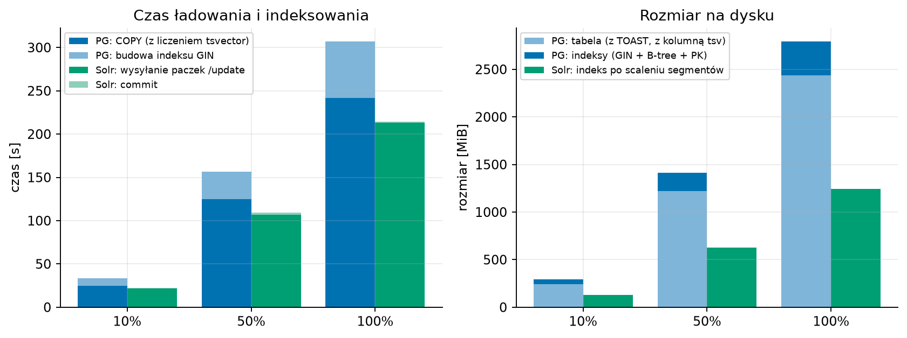
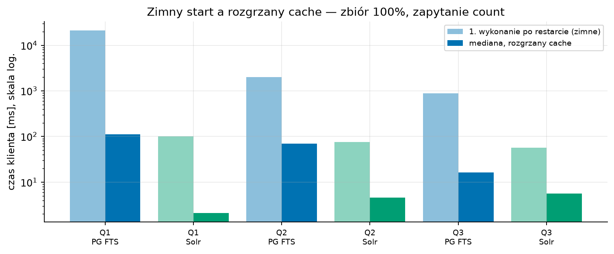
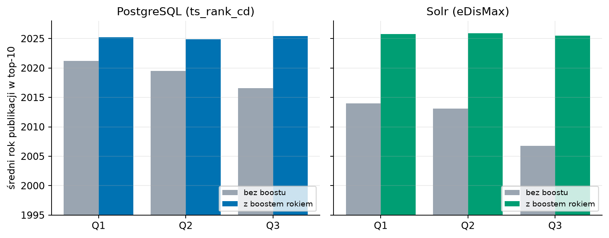
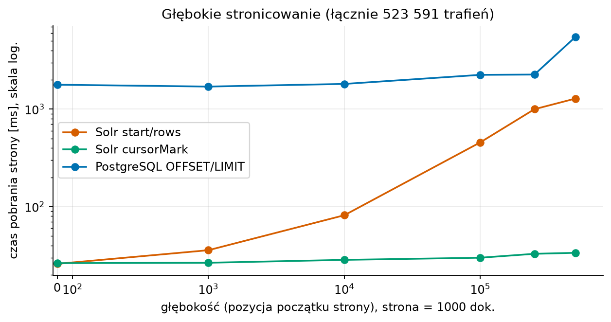
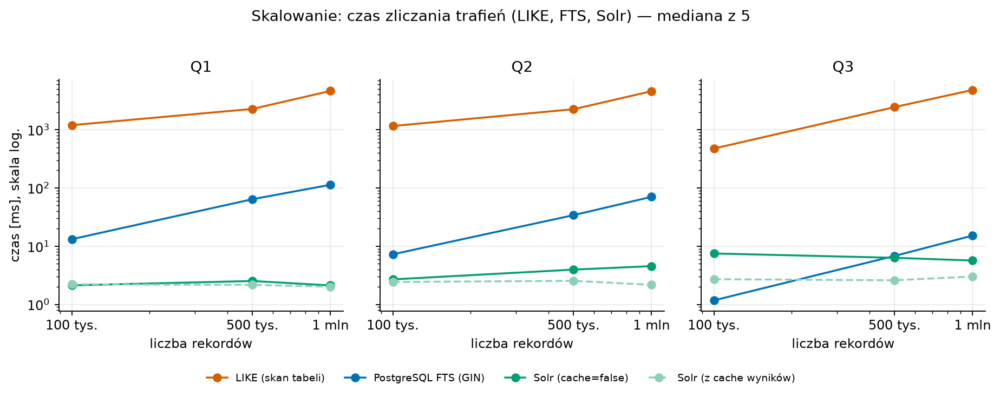
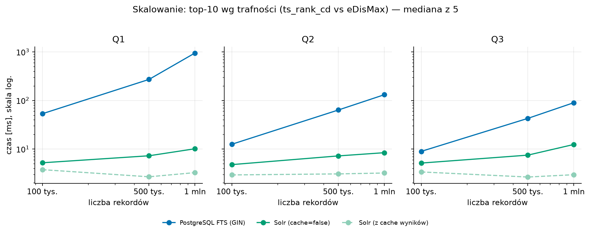
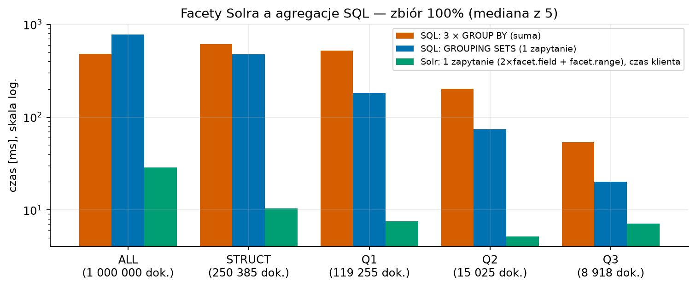

<div class="title-page">
<p class="uni">Politechnika Krakowska</p>
<h1>Wyszukiwanie pełnotekstowe: SQL kontra Solr</h1>
<p class="sub">Laboratorium nr 3 — poziom 5.0</p>
<p class="sub">Przedmiot: Przetwarzanie języka naturalnego</p>
<p class="sub">Prowadzący: dr inż. Wojciech Książek</p>
<p class="authors">Autorzy: &lt;Imię Nazwisko&gt;, &lt;Imię Nazwisko&gt;</p>
<p class="date">Dane i pomiary z: 2026-11-21</p>
</div>

<div class="pb"></div>

[TOC]

<div class="pb"></div>

## 1. Cel i zakres

Porównujemy trzy sposoby przeszukiwania tekstu: `LIKE '%…%'`, indeks pełnotekstowy PostgreSQL (kolumna `tsvector` + indeks GIN)
i Apache Solr 10 — funkcjonalnie i wydajnościowo, na metadanych publikacji arXiv. Zrealizowano poziom 5.0, czyli wymagania
poziomów 3.0 i 4.0 oraz skalowanie (10% / 50% / 100% danych), porównanie facetów z `GROUP BY` i dwa rozszerzenia z listy poziomu 5.0
(głębokie stronicowanie `cursorMark` i aktualizacja danych z synchronizacją do Solra) oraz rozszerzenie z listy 4.0 (boost trafności rokiem).
Każda liczba w tym sprawozdaniu pochodzi z plików w katalogu `results/` wygenerowanych przez skrypty projektu.

## 2. Zbiór danych

- **Źródło:** metadane arXiv udostępnione przez Cornell University (Kaggle `Cornell-University/arxiv`), my korzystamy z kopii
  na Hugging Face: `librarian-bots/arxiv-metadata-snapshot` (pliki parquet).
- **Licencja:** metadane arXiv są udostępnione na licencji **CC0**. Nie używamy danych osobowych: pomijamy pola `authors`,
  `authors_parsed` i `submitter`.
- **Liczba rekordów:** źródło zawiera 3 224 635 rekordów; po usunięciu 83 powtórzonych `id`
  oraz filtrach (abstrakt ≥ 300 znaków, znany rok) zostaje 3 093 551.
  Zbiór 100% to **1 000 000** rekordów wybranych deterministycznie (skrót blake2b z `seed:id`, seed = 42);
  zbiory 50% (500 000) i 10% (100 000) to podzbiory (10% ⊂ 50% ⊂ 100%).
- **Dane nie były powielane** (nie ma pola `copy_no`; arXiv ma ponad 3 mln rekordów, więc nie było takiej potrzeby).
- **Pola:** `id` (klucz, identyfikator arXiv), `title`, `abstract` (tekst), `primary_category` (pierwsza z `categories`), `archive`
  (część `primary_category` przed kropką), `categories` (lista), `year` (rok pierwszej wersji), `license`.
- **Rozmiar:** średnia długość abstraktu 1 048,0 znaków (mediana 1 024);
  CSV 1 167 MiB, JSONL 1 276 MiB (zbiór 100%).
- **Pola kategoryczne:** `primary_category` — 170 wartości, `archive` — 38,
  `license` — 10. **Pole liczbowe:** `year` (1988–2026).

Największe archiwa (zbiór 100%): cs (270 903), math (172 842), cond-mat (114 216), astro-ph (110 736), physics (69 728), hep-ph (44 165).

**Przykładowy rekord:**

```json
{
 "id": "1204.4591",
 "title": "Gamma-ray lines constraints in the NMSSM",
 "abstract": "We present the computation of the loop-induced self-annihilation of dark matter particles into two photons in the framework of the NMSSM. This process is a theoretically clean observable with a \"smoking-gun\" signature but is experimentally very challenging to detect. The rates were computed with the help of the SloopS program, an automatic code initially designed for the evaluation of processes at the one-loop level in the MSSM. We focused on a light neutralino scenario and discuss how the signal can be enhanced in the NMSSM with respect to the MSSM and then compared with the present limits given by the dedicated search of the FERMI-LAT satellite on the monochromatic gamma lines.",
 "primary_category": "hep-ph",
 "archive": "hep-ph",
 "categories": [
  "hep-ph",
  "astro-ph.CO"
 ],
 "year": 2012,
 "license": "http://arxiv.org/licenses/nonexclusive-distrib/1.0/"
}
```

## 3. Środowisko i metodyka pomiarów

| element | wartość |
|---|---|
| procesor | AMD Ryzen 5 3600 6-Core Processor (6 rdzeni, 12 wątków) |
| pamięć RAM | 31.9 GB (Docker: 12 CPU, 16728145920 B RAM) |
| dysk | WDS250G3X0C-00SJG0 (SSD); WDC WD10EZEX-75WN4A1 (HDD) (dane na dysku systemowym, 232 GB) |
| system | Windows 11 (10.0.26300) |
| Docker | 29.5.3 (Docker Desktop) |
| PostgreSQL | 17.12 (Debian 17.12-1.pgdg13+1); `shared_buffers`=1GB, `work_mem`=64MB, `maintenance_work_mem`=1GB, `effective_cache_size`=2GB, `max_parallel_workers_per_gather`=2, JIT=on |
| Solr | 10.1.0 (Lucene 10.4.0), tryb solrcloud (wbudowany ZooKeeper), `SOLR_HEAP`=2g (max sterta JVM 2.0 GB), Eclipse Adoptium OpenJDK 64-Bit Server VM 25.0.5.1 25.0.5.1+2-LTS |
| Python | 3.13.12 (klient: psycopg 3, requests) |

**Metodyka.** Te same dane i te same zapytania w obu systemach. Czasy pochodzą z uruchomień po rozgrzewce (1 uruchomienie
rozgrzewające + 5 pomiarów; podajemy medianę, w plikach JSON także minimum i maksimum). Dla SQL mierzymy
(a) *Execution Time* z `EXPLAIN (ANALYZE, BUFFERS)` — czas serwera — oraz (b) czas po stronie klienta (wykonanie + pobranie wyniku);
dla Solra (a) `QTime` z odpowiedzi (rozdzielczość 1 ms) oraz (b) czas klienta (HTTP + JSON, połączenie utrzymywane — `requests.Session`).
Przy każdym pomiarze zapisujemy dokładne zapytanie (pełny SQL lub pełny URL), liczbę wyników, czas i znacznik czasu
(`results/*.json`). Plany `EXPLAIN` zapytań poziomu 3.0 są w `results/explain/`.

**Cache wyników Solra.** Powtórzone identyczne zapytanie jest w Solrze obsługiwane z `queryResultCache` (QTime ≈ 0 ms), co nie mierzy
kosztu dopasowania i rankingu. Dlatego w benchmarku mierzymy Solra w dwóch wariantach: `cache=false` (parametr lokalny
`{!lucene cache=false}` / `{!edismax … cache=false}` — realne wykonanie) oraz domyślnym (z cache). **W wykresach i wnioskach
używamy wariantu `cache=false`** (a cache pokazujemy osobno). Cache plików systemu operacyjnego jest w obu systemach rozgrzany.

**LIKE.** `LIKE` jest zwykłym skanem tabeli — **nie** założyliśmy indeksu trigramowego (`gin_trgm_ops`), choć rozszerzenie `pg_trgm` jest
zainstalowane. Plan: *Parallel Seq Scan* (do 2 procesów roboczych + proces główny; dla zapytania
z filtrem po `year`/`archive` planista wybiera inny plan).

## 4. Schemat w SQL i w Solrze

### 4.1. PostgreSQL: tabela i indeks pełnotekstowy

Trzy osobne tabele `papers_10`, `papers_50`, `papers_100` (poniżej `papers_100`):

```sql
-- Schemat tabeli zbioru arXiv w PostgreSQL.
-- Plik jest SZABLONEM: papers_100 = papers_10 | papers_50 | papers_100 (podstawia lab3.load_pg).
-- Ręcznie w psql: sed 's/papers_100/papers_100/g' sql/01_schema.sql | psql ...
-- Kolumna tsv jest GENERATED ... STORED: tsvector (konfiguracja 'english', tytuł z wagą A, abstrakt z wagą B)
-- liczy się automatycznie przy INSERT/COPY/UPDATE, więc nie da się go "zapomnieć" zsynchronizować.
-- Indeksów (GIN, B-tree) NIE tworzymy tutaj — powstają po załadowaniu danych (sql/02_indexes.sql).
CREATE EXTENSION IF NOT EXISTS pg_trgm;   -- tylko do eksperymentów; NIE zakładamy indeksu gin_trgm_ops na tekście

DROP TABLE IF EXISTS papers_100 CASCADE;
CREATE TABLE papers_100 (
    id               text PRIMARY KEY,          -- identyfikator arXiv, np. 0704.0001 albo hep-th/9812056
    title            text NOT NULL,
    abstract         text NOT NULL,
    primary_category text NOT NULL,             -- pierwsza kategoria z listy categories, np. astro-ph.GA
    archive          text NOT NULL,             -- część primary_category przed kropką, np. astro-ph
    categories       text[] NOT NULL,
    year             integer NOT NULL,          -- rok pierwszej wersji
    license          text NOT NULL,             -- URL licencji albo 'none'
    updated_at       timestamptz NOT NULL DEFAULT now(),
    tsv              tsvector GENERATED ALWAYS AS (
                         setweight(to_tsvector('english', title), 'A') ||
                         setweight(to_tsvector('english', abstract), 'B')
                     ) STORED
);
```

Indeksy zakładamy **po** załadowaniu danych (szybciej niż przy `COPY`):

```sql
-- Indeksy tabeli papers_100 (szablon jak w 01_schema.sql). Tworzone PO załadowaniu danych (szybciej niż przy COPY).
CREATE INDEX papers_100_tsv_gin ON papers_100 USING gin (tsv);
CREATE INDEX papers_100_year_idx ON papers_100 (year);
CREATE INDEX papers_100_primary_category_idx ON papers_100 (primary_category);
ANALYZE papers_100;
```

Kolumna `tsv` jest `GENERATED … STORED`: tsvector liczy się przy `INSERT`/`COPY`/`UPDATE` automatycznie (konfiguracja `english` =
stoplista angielska + stemmer Snowball/Porter2); tytuł ma wagę A, abstrakt B. Indeks GIN to indeks odwrócony: dla każdego leksemu
lista wierszy, w których występuje. Zapytania używają operatora `@@` (np. `tsv @@ phraseto_tsquery('english','dark matter')`).

### 4.2. Solr: schemat (Schema API) i uzasadnienie flag

Każda kolekcja (`papers_10/50/100`) ma własny configset (kopia `_default`), wyłączone tworzenie pól „w locie”
(`update.autoCreateFields=false` — dokument z nieznanym polem jest odrzucany, sprawdziliśmy to) i wyłączone `autoCommit`/`autoSoftCommit`
(jeden commit na końcu ładowania). Plik `solr/schema.json`:

```json
{
  "add-field": [
    {"name": "title",            "type": "text_en", "indexed": true, "stored": true},
    {"name": "abstract",         "type": "text_en", "indexed": true, "stored": true},
    {"name": "text_all",         "type": "text_en", "indexed": true, "stored": false, "multiValued": true},
    {"name": "primary_category", "type": "string",  "indexed": true, "stored": true, "docValues": true},
    {"name": "archive",          "type": "string",  "indexed": true, "stored": true, "docValues": true},
    {"name": "license",          "type": "string",  "indexed": true, "stored": true, "docValues": true},
    {"name": "categories",       "type": "string",  "indexed": true, "stored": true, "docValues": true, "multiValued": true},
    {"name": "year",             "type": "pint",    "indexed": true, "stored": true, "docValues": true}
  ],
  "add-copy-field": [
    {"source": "title",    "dest": "text_all"},
    {"source": "abstract", "dest": "text_all"}
  ]
}
```

Konfiguracja kolekcji (`solr/collection_config.json`):

```json
{
  "set-user-property": {"update.autoCreateFields": "false"},
  "set-property": {
    "updateHandler.autoCommit.maxTime": -1,
    "updateHandler.autoSoftCommit.maxTime": -1
  }
}
```

| pole | typ | indexed | stored | docValues | multiValued | uzasadnienie |
|---|---|:-:|:-:|:-:|:-:|---|
| `id` | string (uniqueKey) | tak | tak | tak | nie | klucz; wyszukiwanie/usuwanie po id, sortowanie pomocnicze (`id asc`) w `cursorMark` |
| `title` | text_en | tak | tak | — | nie | przeszukiwanie z wagą (`qf=title^3`), `stored` do wyświetlania i podświetlania; docValues nie dotyczy pól analizowanych |
| `abstract` | text_en | tak | tak | — | nie | j.w.; `stored` konieczne dla `hl` (unified highlighter odczytuje tekst z pola stored) |
| `text_all` | text_en | tak | **nie** | — | tak | pole zbiorcze (`copyField` z `title` i `abstract`) dla zapytań poziomu 3.0; nie wyświetlamy go, więc `stored=false` oszczędza miejsce |
| `primary_category` | string | tak | tak | tak | nie | filtry `fq` (indexed), facety i sortowanie (docValues), wyświetlanie (stored) |
| `archive` | string | tak | tak | tak | nie | j.w. |
| `license` | string | tak | tak | tak | nie | j.w. |
| `categories` | string | tak | tak | tak | **tak** | rekord ma listę kategorii; facet po wszystkich kategoriach, filtr po dowolnej |
| `year` | pint | tak | tak | tak | nie | zakresy `fq=year:[a TO b]` (indexed, struktura punktowa), `facet.range`, sortowanie i funkcja `boost` (docValues) |

### 4.3. Łańcuch analizy `text_en`

Typ `text_en` ze schematu `_default` (Solr 10.1.0). **Indeksowanie:** tokenizer `standard` → filtr stop (`lang/stopwords_en.txt`) →
`lowercase` → `englishPossessive` (obcina `'s`) → `keywordMarker` (chroni słowa z `protwords.txt`) → `porterStem`.
**Zapytania:** to samo, z dodatkowym filtrem `synonymGraph` (`synonyms.txt`) na początku.

Porównanie z PostgreSQL (`english`): ten sam pomysł (tokenizacja → małe litery → stoplista → stemming), ale **inne komponenty**:
PostgreSQL używa *parsera* tekstu rozpoznającego typy tokenów (URL, plik, host, słowo złożone z myślnikiem, liczba), słownika Snowball
(Porter2) i własnej stoplisty; Solr — tokenizera Unicode (UAX#29) i klasycznego algorytmu Portera. To źródło różnic opisanych w p. 5.2.


## 5. Porównanie funkcjonalne (poziom 3.0 i 4.0)

### 5.1. Zapytania i wyniki (zbiór 100%, 1 000 000 rekordów)

Wszystkie zapytania dotyczą pól `title` i `abstract` (w Solrze `text_all`, w SQL `tsv`; LIKE: `(title || ' ' || abstract) ILIKE '%…%'`).

- **Q1** — słowo w dowolnej formie: `simulate` (SQL: `plainto_tsquery('english','simulate')`; Solr: `q=text_all:simulate`) + wariant `LIKE '%simulate%'`.
- **Q2** — fraza `dark matter` (SQL: `phraseto_tsquery`; Solr: `q=text_all:"dark matter"`).
- **Q3** — `galaxy AND (cluster OR merger) AND NOT simulation` (SQL: `to_tsquery('english','galaxy & (cluster | merger) & !simulation')`).
- **Q1+fq** — Q1 z filtrem `archive=astro-ph` i latami 2010–2020 (Solr: dwa `fq`; SQL: warunki `WHERE`).

Słowa wybraliśmy tak, by miały wyraźne formy fleksyjne i tysiące trafień; zapytania Solra jako klikalne URL-e są w `docs/zapytania_solr.md`.
Czas SQL = *Execution Time* z `EXPLAIN (ANALYZE, BUFFERS)`, mediana z 5.

| zapytanie | wyniki LIKE | wyniki FTS (SQL) | numFound Solr | czas LIKE [ms] | czas FTS [ms] | QTime Solr [ms] (cache) | QTime Solr [ms] (cache=false) | klient Solr [ms] (cache=false) |
|---|---:|---:|---:|---:|---:|---:|---:|---:|
| **Q1** słowo w dowolnej formie: simulate (simulated, simulates, simulating, simulation…) | 24 333 | 119 222 | 119 255 | 4 754,9 | 120,1 | 0 | 6 | 8,5 |
| **Q2** fraza "dark matter" (słowa obok siebie, w tej kolejności) | 14 655 | 14 955 | 15 025 | 4 629,6 | 66,2 | 0 | 3 | 6,4 |
| **Q3** galaxy AND (cluster OR merger) AND NOT simulation | 7 259 | 8 887 | 8 918 | 4 856,8 | 15,1 | 0 | 4 | 7,2 |
| **Q1+fq** Q1 z filtrem: archive=astro-ph, lata 2010–2020 | 2 138 | 9 447 | 9 449 | 400,6 | 98,7 | 0 | 2 | 6,0 |

Czasy klienta SQL (mediana): Q1 — LIKE 4 718,2 ms, FTS 112,6 ms, Q2 — LIKE 4 639,9 ms, FTS 69,8 ms, Q3 — LIKE 4 908,9 ms, FTS 15,7 ms, Q1+fq — LIKE 412,1 ms, FTS 98,2 ms.
`QTime` w Solrze ma rozdzielczość 1 ms; wariant „cache” zwraca wynik z `queryResultCache` (0 ms).

**Plany.** `LIKE` → Parallel Seq Scan po całej tabeli;
FTS → *Bitmap Index Scan* na indeksie GIN + *Bitmap Heap Scan* (Q1: 119 222 wierszy).
Wariant `Q1+fq`: LIKE używa *Parallel Index Scan* po indeksie B-tree na `year` (zawęża zbiór do lat 2010–2020), a `LIKE` i `archive` sprawdza jako filtr
(401 ms zamiast 4 755 ms; patrz `results/explain/level3_Q1+fq_like.txt`). Tabela 2 438 MiB
jest większa niż `shared_buffers` (1GB), więc skan `LIKE` czyta strony także z cache systemu operacyjnego (`Buffers: … read=…` w planie) — to też część jego kosztu.

### 5.2. Skąd różnice w liczbie wyników


**FTS a LIKE.** `LIKE '%simulate%'` zwraca 24 333 dokumentów, FTS 119 222: indeks pełnotekstowy
znajduje wszystkie formy fleksyjne (po stemmingu `simulated`, `simulations`, `simulating`, `simulation` → `simul`), a `LIKE` tylko ciągi zawierające
dosłownie `simulate` (nie znajdzie `simulation`: 94 901 dokumentów jest w FTS, a nie w LIKE).
Przykłady: 0704.0021 (*simulations*) i 0704.0022 (*simulating*) — są w FTS, nie ma ich w LIKE. Odwrotnie (12 dok.): `LIKE` znajduje
**podciągi**, np. 0709.3304 zawiera `resimulate` (stem `resimul`, inny niż `simul`). Podobnie w Q3 `LIKE '%cluster%'` łapie `supercluster`/`protocluster`
(np. 0706.1593, 0706.2865), których FTS nie uznaje za słowo `cluster` (342 dok. tylko w LIKE), a FTS znajduje formy takie jak `clusters`/`galaxies`
(np. 0704.0478, 0704.2057), których `LIKE` z dosłownym wzorcem `galaxy` nie dopasuje (`galaxies` ≠ `galaxy`): 1 970 dok. tylko w FTS.
Dla frazy (Q2) `LIKE` wymaga dosłownie `dark matter` z jedną spacją, więc nie znajdzie `dark-matter` (np. 0705.0429, 0708.1987) ani `(dark) matter` (0708.2910), które FTS uznaje za frazę
(373 dok. tylko w FTS); odwrotnie, `LIKE` dopasuje podciąg także wtedy, gdy słowo jest częścią tokenu złożonego, jak `energy/dark matter` (0711.4288) czy `dark matter-wave` (0712.1543), których FTS PostgreSQL nie uznaje za frazę (73 dok.).

**FTS (PostgreSQL) a Solr.** Różnica jest mała (Q1: 2 dok. tylko w SQL i 35 tylko w Solrze na 119 222;
Q2: 0 / 70 na 14 955; Q3: 0 / 31 na 8 887)
i wynika z **tokenizacji**, nie ze stemmingu:

- **Tylko w Solrze:** 1008.1143 — tekst zawiera `simulation/data`; parser PostgreSQL rozpoznaje to jako jeden token typu *file*
  (`simulation/data`), więc nie ma w nim leksemu `simul`; tokenizer Solra dzieli na `/`. Podobnie 1208.3789 — słowo `simulator` ukryte w adresie
  `www2.cs.uic.edu/~dasgupta/financial-simulator-files`, który PostgreSQL traktuje jako *url*/*host*/*url_path*.
- **Tylko w PostgreSQL:** 1810.03390 — `local_qasm_simulator`: PostgreSQL dzieli na podkreślniku (`local`, `qasm`, `simul`), a `StandardTokenizer`
  Solra (UAX#29) **nie** dzieli na `_`, więc `simulator` nie jest osobnym tokenem. Podobnie 2207.07417 (`ms08_simulating_quantum_tensor_contraction`).
- **Fraza „dark matter”:** 0712.1543 zawiera `dark matter-wave` — w PostgreSQL słowo złożone `matter-wave` zajmuje kilka pozycji
  (`matter-wav`, `matter`, `wave`), więc `dark` i `matter` nie sąsiadują i fraza nie jest znaleziona; w Solrze `matter-wave` rozbija się na `matter` i `wave` kolejnych pozycji.
- **Q3 (tylko w Solrze):** 0710.0955 zawiera `clusters/groups`, 0801.1109 — `merger/interaction`, 0808.0461 — `interacting/merger`: PostgreSQL widzi to jako jeden token
  typu *file* (leksemy `cluster`/`merger` nie powstają, więc warunek `cluster | merger` nie jest spełniony), a Solr rozdziela na `/` i dokument pasuje.
- Pozostałe różnice: inne **stoplisty** (Lucene vs PostgreSQL) i różne warianty algorytmu Portera (Solr: klasyczny Porter, PostgreSQL: Snowball/Porter2) — mogą dawać
  inne stemy dla rzadkich słów.

Pełne listy przykładów są w `results/level3_diffs.json`.

### 5.3. Ranking top-10: `ts_rank_cd` (PostgreSQL) a eDisMax (Solr)

SQL: `ts_rank_cd(tsv, query)` (wagi tsvector: A = 1,0 dla tytułu, B = 0,4 dla abstraktu), `ORDER BY rank DESC, id ASC LIMIT 10`.
Solr: `defType=edismax`, `qf=title^3 abstract`, dla frazy dodatkowo `pf=title^3 abstract`, `sort=score desc, id asc` (BM25). Pełne zapytania i URL-e są w `results/level4.json`.

**Q1** — słowo w dowolnej formie: simulate (simulated, simulates, simulating, simulation…). Wspólnych dokumentów w top-10: **0**, w top-100: **7**; `ts_rank_cd` z normalizacją długości (flaga 2): top-10 **1**, top-100 **14**. Średnia długość abstraktu w top-10: PG 1 606, PG norm. 427, Solr 1 130 znaków.

| # | PG id | ts_rank_cd | rok | tytuł (PG) | Solr id | BM25 | rok | tytuł (Solr) |
|---:|---|---:|---:|---|---|---:|---:|---|
| 1 | 2306.00223 | 9,00 | 2023 | Customized Co-Simulation Environment for Aut… | 2308.07176 | 8,94 | 2023 | Perfect simulation from unbiased simulation |
| 2 | 1712.07612 | 8,40 | 2017 | Advanced EMT and Phasor-Domain Hybrid Simula… | 2506.06958 | 8,94 | 2025 | Simulating Society Requires Simulating Thoug… |
| 3 | 2503.08936 | 8,20 | 2025 | Simulator Ensembles for Trustworthy Autonomo… | 2106.07901 | 8,61 | 2021 | FIGARO Simulation: FIlaments & GAlactic Radi… |
| 4 | 1712.02806 | 7,40 | 2017 | From estimation of quantum probabilities to … | 2210.14324 | 8,61 | 2022 | The Championship Simulator: Architectural Si… |
| 5 | 2204.00763 | 7,00 | 2022 | Metaphorical User Simulators for Evaluating … | cond-mat/9402049 | 8,61 | 1994 | Simulated-tempering approach to spin-glass s… |
| 6 | 2211.05892 | 7,00 | 2022 | The electron cyclotron drift instability: a … | quant-ph/0403082 | 8,61 | 2004 | Gate simulation and lower bounds on the simu… |
| 7 | 2410.00185 | 7,00 | 2024 | The Patterns of Life Human Mobility Simulati… | 2308.07842 | 8,49 | 2023 | How to Simulate Realistic Survival Data? A S… |
| 8 | 2404.19356 | 6,60 | 2024 | A Concept for Semi-Automatic Configuration o… | 0708.1051 | 8,37 | 2007 | Deconvolution by simulation |
| 9 | 2605.09808 | 6,60 | 2026 | Quantifying the Utility of User Simulators f… | 1002.2281 | 8,37 | 2010 | Regulation Simulation |
| 10 | 1205.2523 | 6,40 | 2012 | Simulated Tempering and Magnetizing: An Appl… | 1110.1274 | 8,37 | 2011 | Simulations of the Hyades |

**Q2** — fraza "dark matter" (słowa obok siebie, w tej kolejności). Wspólnych dokumentów w top-10: **0**, w top-100: **5**; `ts_rank_cd` z normalizacją długości (flaga 2): top-10 **1**, top-100 **16**. Średnia długość abstraktu w top-10: PG 1 507, PG norm. 423, Solr 964 znaków.

| # | PG id | ts_rank_cd | rok | tytuł (PG) | Solr id | BM25 | rok | tytuł (Solr) |
|---:|---|---:|---:|---|---|---:|---:|---|
| 1 | 2604.03907 | 7,80 | 2026 | Intracluster Light as a Probe for Dark Matte… | 1110.5718 | 18,35 | 2011 | The dark-matter world: Are there dark-matter… |
| 2 | 1201.2400 | 7,40 | 2012 | On the capture of dark matter by neutron sta… | 1109.5580 | 17,83 | 2011 | Dark matter |
| 3 | 2210.06498 | 6,80 | 2022 | The local dark matter distribution in self-i… | 2410.10424 | 17,83 | 2024 | Dark Matter |
| 4 | 2010.02219 | 6,40 | 2020 | Dark-matter-deficient dwarf galaxies form vi… | physics/9908015 | 17,83 | 1999 | Dark Matter |
| 5 | 2205.12950 | 6,20 | 2022 | Searches for Connections between Dark Matter… | 2608.25954 | 17,71 | 2026 | Dark Matters of Principle: Principles in the… |
| 6 | 2404.02646 | 6,00 | 2024 | Ultralight scalar dark matter versus nonadia… | hep-ph/9406376 | 17,71 | 1994 | Sensitivity Of Dark Matter Dectectors To Sus… |
| 7 | 2411.10149 | 6,00 | 2024 | Directional Direct Detection of MeV Scale Bo… | 2412.16283 | 17,11 | 2024 | Dark Matter-Electron Detectors for Dark Matt… |
| 8 | 1101.4936 | 5,80 | 2011 | Asymmetric Dark Matter from Leptogenesis | 2502.12030 | 17,11 | 2025 | Fuzzy dark matter fails to explain the dark … |
| 9 | 1510.06275 | 5,80 | 2015 | Testing the Bose-Einstein Condensate dark ma… | 0810.0713 | 16,66 | 2008 | A Theory of Dark Matter |
| 10 | 1912.08468 | 5,80 | 2019 | DUNE potential for sub-GeV dark matter in pr… | 0907.1912 | 16,66 | 2009 | Dark Matter Astrophysics |

**Q3** — galaxy AND (cluster OR merger) AND NOT simulation. Wspólnych dokumentów w top-10: **0**, w top-100: **9**; `ts_rank_cd` z normalizacją długości (flaga 2): top-10 **0**, top-100 **11**. Średnia długość abstraktu w top-10: PG 1 606, PG norm. 461, Solr 1 207 znaków.

| # | PG id | ts_rank_cd | rok | tytuł (PG) | Solr id | BM25 | rok | tytuł (Solr) |
|---:|---|---:|---:|---|---|---:|---:|---|
| 1 | 1811.04958 | 5,16 | 2018 | Detection of a Star Forming Galaxy in the Ce… | astro-ph/0305512 | 25,61 | 2003 | Interactions and Mergers of Cluster Galaxies |
| 2 | 2404.06539 | 4,76 | 2024 | First Search for High-Energy Neutrino Emissi… | astro-ph/0612185 | 23,73 | 2006 | Radio Observations of Galaxy Clusters: Conne… |
| 3 | 1606.02362 | 4,64 | 2016 | Recent galaxy mergers and residual star form… | astro-ph/0105458 | 22,78 | 2001 | Merger Shocks and Nonthermal Processes in Cl… |
| 4 | 1609.08339 | 4,48 | 2016 | Tracing low-mass galaxy clusters with radio … | astro-ph/0406181 | 22,78 | 2004 | Mergers and Non-Thermal Processes in Cluster… |
| 5 | 0712.1819 | 4,47 | 2007 | The Angular Clustering of Distant Galaxy Clu… | astro-ph/9909243 | 22,78 | 1999 | Reconstructing the Merger History of the A32… |
| 6 | 1708.02449 | 4,31 | 2017 | The extended ROSAT-ESO Flux-Limited X-ray Ga… | astro-ph/9609095 | 21,60 | 1996 | Mergers of Globular Clusters |
| 7 | 2609.19509 | 4,12 | 2026 | The extreme Disturbed Galaxy Cluster Sample … | 1408.0666 | 21,59 | 2014 | Abell 2384: the galaxy population of a clust… |
| 8 | astro-ph/0503089 | 3,90 | 2005 | Velocity Dispersion of 335 Galaxy Clusters S… | 1806.05186 | 21,59 | 2018 | KYDISC: Galaxy Morphology, Quenching, and Me… |
| 9 | 2603.06821 | 3,90 | 2026 | Caught in the web: galaxy mergers along cosm… | 2407.18075 | 21,59 | 2024 | Merger Shocks Enhance Quenching in Local Gal… |
| 10 | 1104.3530 | 3,75 | 2011 | Dark matter searches with Cherenkov telescop… | astro-ph/0312454 | 21,59 | 2003 | The Off-Axis Galaxy Cluster Merger Abell 115 |

**Wyjaśnienie różnic.** Zbiór trafień jest (prawie) ten sam, różni się **kolejność**:

- `ts_rank_cd` mierzy *gęstość i bliskość* wystąpień (*cover density*) i domyślnie **nie normalizuje długości** dokumentu — dłuższe abstrakty z wieloma wystąpieniami
  zdobywają wysokie wyniki. Włączenie normalizacji długości (flaga 2) zwiększa zgodność top-100 z Solrem z 7/5/9
  do 14/16/11 (Q1/Q2/Q3), ale nie do pełnej zgodności.
- BM25 (Solr) uwzględnia **IDF** (rzadkie słowa ważą więcej), **nasycenie częstości** (kolejne wystąpienia coraz mniej podnoszą wynik)
  i **normalizację długości pola** (krótki tytuł z trafieniem wygrywa) — stąd w Solrze na czele krótkie tytuły takie jak *Dark matter* (Q2).
- Różne **wagi pól**: `title^3` w eDisMax (mnożnik 3 względem abstraktu) kontra A = 1,0 i B = 0,4 w tsvectorze (stosunek 2,5) — oraz inne skale wyników (brak porównywalności wartości liczbowych).
- Solr dla frazy dodaje `pf` (premia za frazę w polu), a PostgreSQL ma frazę w samym `tsquery`.

### 5.4. `GROUP BY` w SQL i facety Solra dla wyników zapytania; podświetlanie

Dla każdego zapytania: agregacja `GROUP BY primary_category` / `archive` w PostgreSQL oraz `facet.field=primary_category&facet.field=archive` w Solrze (top-5 wartości):

**Q1**

| # | SQL primary_category | n | Solr primary_category | n | SQL archive | n | Solr archive | n |
|---:|---|---:|---|---:|---|---:|---|---:|
| 1 | quant-ph | 6 049 | quant-ph | 6 050 | cs | 26 094 | cs | 26 105 |
| 2 | cs.RO | 5 431 | cs.RO | 5 433 | astro-ph | 22 236 | astro-ph | 22 239 |
| 3 | stat.ME | 4 786 | stat.ME | 4 787 | cond-mat | 17 054 | cond-mat | 17 057 |
| 4 | astro-ph.GA | 4 717 | astro-ph.GA | 4 718 | physics | 15 988 | physics | 15 996 |
| 5 | astro-ph | 4 175 | astro-ph | 4 175 | stat | 7 514 | stat | 7 516 |

**Q2**

| # | SQL primary_category | n | Solr primary_category | n | SQL archive | n | Solr archive | n |
|---:|---|---:|---|---:|---|---:|---|---:|
| 1 | hep-ph | 4 656 | hep-ph | 4 661 | astro-ph | 7 721 | astro-ph | 7 772 |
| 2 | astro-ph.CO | 3 179 | astro-ph.CO | 3 206 | hep-ph | 4 656 | hep-ph | 4 661 |
| 3 | astro-ph | 1 987 | astro-ph | 1 994 | gr-qc | 1 063 | gr-qc | 1 069 |
| 4 | astro-ph.GA | 1 673 | astro-ph.GA | 1 686 | physics | 685 | physics | 686 |
| 5 | gr-qc | 1 063 | gr-qc | 1 069 | hep-ex | 386 | hep-ex | 386 |

**Q3**

| # | SQL primary_category | n | Solr primary_category | n | SQL archive | n | Solr archive | n |
|---:|---|---:|---|---:|---|---:|---|---:|
| 1 | astro-ph | 3 005 | astro-ph | 3 015 | astro-ph | 8 673 | astro-ph | 8 704 |
| 2 | astro-ph.GA | 2 677 | astro-ph.GA | 2 689 | gr-qc | 107 | gr-qc | 107 |
| 3 | astro-ph.CO | 2 173 | astro-ph.CO | 2 178 | hep-ph | 61 | hep-ph | 61 |
| 4 | astro-ph.HE | 504 | astro-ph.HE | 508 | physics | 25 | physics | 25 |
| 5 | astro-ph.SR | 184 | astro-ph.SR | 184 | hep-th | 7 | hep-th | 7 |

Liczności są zbliżone, lecz niezupełnie równe, bo zbiory trafień różnią się o kilkadziesiąt dokumentów (p. 5.2). Dla zbiorów wyznaczonych filtrem strukturalnym są identyczne (p. 8).

**Podświetlanie (Q2).** Solr: `hl=true&hl.fl=abstract,title&hl.method=unified&hl.snippets=2&hl.fragsize=220` (tag `<em>`), dokument `1110.5718`:

> We attempt to answer whether neutrinos and antineutrinos, such as those in the cosmic neutrino background, would clusterize among themselves or even with other <em>dark-matter</em> particles, under certain time span, say 1 Gyr. With neutrino masses in place, the similarity with the ordinary matter increases and so is our confidence for neutrino clustering if time is long enough. In particular, the clusterings could happen with some seeds (cf. see the text for definition), the chance in the <em>dark-matter</em> world to form <em>dark-matter</em> galaxies increases. If the <em>dark-matter</em> galaxies would exist in a time span of 1 Gyr, then they might even dictate the formation of the ordinary galaxies (i.e. the <em>dark-matter</em> galaxies get formed first); thus, the implications for the structure of our Universe would be tremendous.

PostgreSQL: `ts_headline('english', abstract, query, 'MaxFragments=2, MaxWords=35, MinWords=15')`, dokument `2604.03907`:

> assess whether intracluster light (ICL) can serve as an observational discriminator of <em>dark</em> <em>matter</em> physics. The self-interacting <em>dark</em> <em>matter</em> (SIDM) model has gained increasing attention as a possible resolution to small-scale discrepancies between ... collisionless cold <em>dark</em> <em>matter</em> (CDM) simulations and observations, predicting distinct tidal interaction histories within galaxy clusters. We analyze Cluster-EAGLE zoom-in galaxy clusters re-simulated from identical initial conditions in both CDM and SIDM

Solr zwraca fragmenty razem z wynikiem w jednym żądaniu (unified highlighter, tekst z pola `stored`); PostgreSQL wymaga osobnego wywołania `ts_headline` na surowym tekście
(ponownie parsuje dokument — koszt rośnie liniowo z liczbą podświetlanych dokumentów; dla 10 dokumentów Q2: 3,8 ms). Fragmenty wybierane są inaczej
(Solr — okna wokół najgęstszych trafień, `ts_headline` — wg `MaxFragments/MinWords/MaxWords`), a znaczniki `<em>` ustawiamy w obu.

## 6. Pomiary wydajności

### 6.1. Ładowanie i indeksowanie

| zbiór | PG: COPY [s] | PG: GIN [s] | PG: B-tree×2 [s] | PG: ANALYZE [s] | PG: razem [s] | Solr: wysyłanie [s] | Solr: commit [s] | Solr: razem [s] |
|---|---:|---:|---:|---:|---:|---:|---:|---:|
| 10% (100 000) | 24,8 | 8,5 | 0,2 | 0,7 | 34,1 | 21,7 | 0,3 | 22,6 |
| 50% (500 000) | 124,6 | 32,1 | 0,7 | 0,8 | 158,2 | 106,6 | 2,7 | 114,8 |
| 100% (1 000 000) | 241,7 | 65,3 | 1,7 | 1,0 | 309,7 | 213,0 | 1,2 | 220,1 |

`COPY` w PostgreSQL zawiera obliczanie kolumny `tsv` (to ona jest kosztowna), indeks GIN budujemy osobno po załadowaniu. Solr: paczki po 5000 dokumentów JSON
na `/update`, jeden commit na końcu; po załadowaniu `numFound` = liczba wierszy w tabeli (10%: 100 000, 50%: 500 000, 100%: 1 000 000; zgodność: tak).



Rozmiar na dysku (zbiór 100%): PostgreSQL — tabela z TOAST 2 438 MiB (zawiera tekst oraz kolumnę `tsv`, średnio 1 188 B/wiersz),
indeks GIN 301 MiB, wszystkie indeksy 355 MiB; Solr — indeks 1 241 MiB po scaleniu segmentów
(zaraz po commicie 2 101 MiB — w tle trwał jeszcze merge, stare segmenty zostają na dysku do kolejnego commitu; plus dziennik transakcji `tlog`, bo `autoCommit` jest wyłączony).

### 6.2. Czasy zapytań (zbiór 100%, mediana z 5)

Tryb **count** — liczba trafień (SQL `SELECT count(*)`, Solr `rows=0`); tryb **top-10** — 10 najlepszych wg trafności (SQL `ts_rank_cd … LIMIT 10`, Solr eDisMax; `LIKE` nie ma rankingu).

| zapytanie | tryb | metoda | wyniki | czas serwera: mediana [ms] | min–maks [ms] | czas klienta: mediana [ms] |
|---|---|---|---:|---:|---:|---:|
| Q1 | count | LIKE | 24 333 | 4 631,8 | 4 562,7–4 719,7 | 4 674,1 |
| Q1 | count | PostgreSQL FTS | 119 222 | 113,3 | 106,7–121,0 | 111,6 |
| Q1 | count | Solr (cache=false) | 119 255 | 0,0 | 0,0–0,0 | 2,1 |
| Q1 | count | Solr (cache) | 119 255 | 0,0 | 0,0–0,0 | 2,0 |
| Q1 | top10 | PostgreSQL FTS | 10 | 952,5 | 932,2–1 002,1 | 963,8 |
| Q1 | top10 | Solr (cache=false) | 10 z 119 255 | 7,0 | 7,0–7,0 | 10,1 |
| Q1 | top10 | Solr (cache) | 10 z 119 255 | 0,0 | 0,0–0,0 | 3,3 |
| Q2 | count | LIKE | 14 655 | 4 579,2 | 4 504,7–4 674,2 | 4 553,2 |
| Q2 | count | PostgreSQL FTS | 14 955 | 70,3 | 66,5–72,7 | 70,4 |
| Q2 | count | Solr (cache=false) | 15 025 | 2,0 | 2,0–3,0 | 4,5 |
| Q2 | count | Solr (cache) | 15 025 | 0,0 | 0,0–0,0 | 2,2 |
| Q2 | top10 | PostgreSQL FTS | 10 | 131,7 | 127,8–148,6 | 129,6 |
| Q2 | top10 | Solr (cache=false) | 10 z 15 025 | 6,0 | 5,0–6,0 | 8,4 |
| Q2 | top10 | Solr (cache) | 10 z 15 025 | 0,0 | 0,0–1,0 | 3,2 |
| Q3 | count | LIKE | 7 259 | 4 817,1 | 4 770,0–4 886,3 | 4 818,1 |
| Q3 | count | PostgreSQL FTS | 8 887 | 15,2 | 14,9–16,3 | 16,1 |
| Q3 | count | Solr (cache=false) | 8 918 | 3,0 | 3,0–3,0 | 5,7 |
| Q3 | count | Solr (cache) | 8 918 | 0,0 | 0,0–0,0 | 3,0 |
| Q3 | top10 | PostgreSQL FTS | 10 | 90,1 | 88,0–105,4 | 91,5 |
| Q3 | top10 | Solr (cache=false) | 10 z 8 918 | 9,0 | 8,0–9,0 | 12,4 |
| Q3 | top10 | Solr (cache) | 10 z 8 918 | 0,0 | 0,0–0,0 | 3,0 |

Czas serwera: SQL — *Execution Time* z `EXPLAIN ANALYZE`; Solr — `QTime` (rozdzielczość 1 ms, stąd wartości całkowite i „0”). Czas klienta zawiera narzut HTTP/JSON (Solr)
albo komunikacji z bazą (SQL). Dokładne zapytania i wszystkie pomiary: `results/benchmark.json`.

**Zimny start.** Metoda: `docker compose restart postgres solr` (czyści `shared_buffers` i pamięć JVM) oraz zrzut page cache maszyny wirtualnej Dockera
(`drop_caches` — wykonany: tak). Pierwsze wykonanie po restarcie, zbiór 100%, tryb count:

| zapytanie | PG FTS: 1. wykonanie [ms] | PG FTS: rozgrzany [ms] | Solr: 1. wykonanie [ms] | Solr: rozgrzany [ms] |
|---|---:|---:|---:|---:|
| Q1 | 20 983 | 111,6 | 100 | 2,1 |
| Q2 | 1 998 | 70,4 | 76 | 4,5 |
| Q3 | 882 | 16,1 | 57 | 5,7 |



## 7. Rozszerzenia

### 7.1. Boost trafności rokiem (poziom 4.0)

Cel: nowsze publikacje wyżej. Funkcja `f(year) = exp(0,08·(year − 2025))` — każdy rok wstecz zmniejsza wynik o ok. 8%.
Solr: parametr eDisMax `boost=exp(mul(0.08,sub(year,2025)))` (mnożnik wyniku BM25, pole `year` z docValues);
SQL: `ts_rank_cd(tsv, q) * exp(0.08 * (year - 2025))`. Zapytania i URL-e: `results/level4_boost.json`.

| zapytanie | system | średni rok top-10 przed | po | średni rok top-100 przed | po | rozkład lat top-10 przed (początek 5-latki: liczba) | po |
|---|---|---|---|---|---|---|---|
| Q1 | PostgreSQL | 2 021,2 | 2 025,2 | 2 021,2 | 2 024,6 | '2010': 1, '2015': 2, '2020': 5, '2025': 2 | '2020': 2, '2025': 8 |
| Q1 | Solr | 2 014,0 | 2 025,8 | 2 015,7 | 2 025,5 | '1990': 1, '2000': 1, '2005': 1, '2010': 2, '2020': 4, '2025': 1 | '2025': 10 |
| Q2 | PostgreSQL | 2 019,5 | 2 024,9 | 2 017,8 | 2 024,5 | '2010': 2, '2015': 2, '2020': 5, '2025': 1 | '2020': 4, '2025': 6 |
| Q2 | Solr | 2 013,1 | 2 025,9 | 2 011,9 | 2 025,6 | '1990': 1, '1995': 1, '2005': 2, '2010': 2, '2020': 2, '2025': 2 | '2025': 10 |
| Q3 | PostgreSQL | 2 016,6 | 2 025,4 | 2 016,5 | 2 023,7 | '2005': 2, '2010': 1, '2015': 4, '2020': 1, '2025': 2 | '2020': 2, '2025': 8 |
| Q3 | Solr | 2 006,8 | 2 025,5 | 2 009,2 | 2 024,7 | '1995': 2, '2000': 4, '2005': 1, '2010': 1, '2015': 1, '2020': 1 | '2020': 2, '2025': 8 |

**Q1 — top-10 przed i po boostcie** (rok i tytuł):

| # | PG przed | tytuł | PG po | tytuł | Solr przed | tytuł | Solr po | tytuł |
|---|---|---|---|---|---|---|---|---|
| 1 | 2023 | Customized Co-Simulation Environmen… | 2025 | Simulator Ensembles for Trustworthy… | 2023 | Perfect simulation from unbiased si… | 2025 | Simulating Society Requires Simulat… |
| 2 | 2017 | Advanced EMT and Phasor-Domain Hybr… | 2023 | Customized Co-Simulation Environmen… | 2025 | Simulating Society Requires Simulat… | 2026 | From Simulated Citizens to Simulate… |
| 3 | 2025 | Simulator Ensembles for Trustworthy… | 2026 | Quantifying the Utility of User Sim… | 2021 | FIGARO Simulation: FIlaments & GAla… | 2026 | Simulated Reasoning is Reasoning |
| 4 | 2017 | From estimation of quantum probabil… | 2026 | Escape from Callback Hell! A New Pr… | 2022 | The Championship Simulator: Archite… | 2026 | Controllable User Simulation |
| 5 | 2022 | Metaphorical User Simulators for Ev… | 2026 | Mitigating Simulator Dependence in … | 1994 | Simulated-tempering approach to spi… | 2026 | Simulated Control Evals |
| 6 | 2022 | The electron cyclotron drift instab… | 2026 | One Frozen Simulator Is Not Enough:… | 2004 | Gate simulation and lower bounds on… | 2026 | One Frozen Simulator Is Not Enough:… |
| 7 | 2024 | The Patterns of Life Human Mobility… | 2024 | The Patterns of Life Human Mobility… | 2023 | How to Simulate Realistic Survival … | 2026 | Simulation-Based Imaging: Learning … |
| 8 | 2024 | A Concept for Semi-Automatic Config… | 2026 | Integration, Enhancements and Evalu… | 2007 | Deconvolution by simulation | 2025 | Accurate simulations of magnetic ex… |
| 9 | 2026 | Quantifying the Utility of User Sim… | 2025 | Parallelizing a modern GPU simulator | 2010 | Regulation Simulation | 2026 | Learning to Simulate Human Dialogue |
| 10 | 2012 | Simulated Tempering and Magnetizing… | 2025 | MultiCoSim: A Python-based Multi-Fi… | 2011 | Simulations of the Hyades | 2026 | Faithful Simulation of Broadcast Me… |

**Q2 — top-10 przed i po boostcie** (rok i tytuł):

| # | PG przed | tytuł | PG po | tytuł | Solr przed | tytuł | Solr po | tytuł |
|---|---|---|---|---|---|---|---|---|
| 1 | 2026 | Intracluster Light as a Probe for D… | 2026 | Intracluster Light as a Probe for D… | 2011 | The dark-matter world: Are there da… | 2026 | Dark Matters of Principle: Principl… |
| 2 | 2012 | On the capture of dark matter by ne… | 2026 | Dark Matter as Screened Ordinary Ma… | 2011 | Dark matter | 2026 | Holographic Dark Matter |
| 3 | 2022 | The local dark matter distribution … | 2026 | Galaxy and Halo Assembly Bias in Al… | 2024 | Dark Matter | 2026 | Is dark matter decaying ? |
| 4 | 2020 | Dark-matter-deficient dwarf galaxie… | 2026 | The large cores of dark matter and … | 1999 | Dark Matter | 2026 | Intracluster Light as a Probe for D… |
| 5 | 2022 | Searches for Connections between Da… | 2024 | Ultralight scalar dark matter versu… | 2026 | Dark Matters of Principle: Principl… | 2026 | Cold Dark Matter and Self-Interacti… |
| 6 | 2024 | Ultralight scalar dark matter versu… | 2024 | Directional Direct Detection of MeV… | 1994 | Sensitivity Of Dark Matter Dectecto… | 2025 | Fuzzy dark matter fails to explain … |
| 7 | 2024 | Directional Direct Detection of MeV… | 2024 | How does the velocity anisotropy of… | 2024 | Dark Matter-Electron Detectors for … | 2026 | Dark Matter from Eternity |
| 8 | 2011 | Asymmetric Dark Matter from Leptoge… | 2022 | The local dark matter distribution … | 2025 | Fuzzy dark matter fails to explain … | 2026 | Is Dark Matter Really Matter? |
| 9 | 2015 | Testing the Bose-Einstein Condensat… | 2026 | Kerr-like black holes shadow surrou… | 2008 | A Theory of Dark Matter | 2026 | Qubits for Dark Matter Hunting |
| 10 | 2019 | DUNE potential for sub-GeV dark mat… | 2025 | Dark Matter Substructure: A Lensing… | 2009 | Dark Matter Astrophysics | 2026 | Ultralight Axial Dark Matter |



Wniosek: boost działa w obu systemach i przesuwa top-10 ku nowszym publikacjom (średni rok w top-10 rośnie o 4,0–18,7 lat zależnie od zapytania i systemu); po boostcie wspólnych dokumentów w top-10 jest
1/1/3 (Q1/Q2/Q3). Boost jest zapisywany jako jedna deklaratywna funkcja w parametrach zapytania
(Solr), natomiast w SQL musi być wpisany w `ORDER BY` — przez to ranking trzeba policzyć dla wszystkich trafień, bez możliwości zatrzymania się wcześniej.

### 7.2. Głębokie stronicowanie: `start/rows` a `cursorMark`

Zapytanie szerokie `text_all:(model OR method)` (523 591 trafień, zbiór 100%), sortowanie `score desc, id asc` (porządek całkowity — wymagany dla `cursorMark`),
strona = 1000 dokumentów. `cursorMark` jest bezstanowy: kursor uzyskany po przejściu do pozycji D można użyć wielokrotnie, więc mierzymy to samo żądanie powtórzone 3×
(mediana); osobno podajemy koszt *dojścia* do głębokości D (suma kolejnych stron). SQL: `ORDER BY ts_rank_cd DESC, id LIMIT 1000 OFFSET D`.
Strony pobrane `start/rows` i `cursorMark` były identyczne we wszystkich pomiarach: True.

| głębokość D | Solr start/rows [ms] | Solr cursorMark [ms] | dojście kursorem do D [s] | SQL OFFSET [ms] |
|---:|---:|---:|---:|---:|
| 0 | 26,0 | 26,4 | 0,00 | 1 781 |
| 1 000 | 35,8 | 26,6 | 0,03 | 1 704 |
| 10 000 | 81,8 | 28,5 | 0,33 | 1 814 |
| 100 000 | 457,1 | 30,0 | 3,16 | 2 248 |
| 250 000 | 999,1 | 32,9 | 7,83 | 2 264 |
| 500 000 | 1 283,7 | 33,7 | 15,75 | 5 493 |



Czas `start/rows` rośnie z głębokością (Solr utrzymuje kolejkę priorytetową o rozmiarze `start+rows`): od 26 ms na początku do
1 284 ms przy D = 500 000; `cursorMark` pozostaje stały (~34 ms), bo kursor niesie wartość sortowania ostatniego dokumentu
i serwer zaczyna od tego miejsca. W SQL `OFFSET` musi policzyć i posortować wszystkie trafienia (ranking) — 5 493 ms przy D = 500 000
(i już ok. 1 781 ms dla pierwszej strony). Cena `cursorMark`: tylko do przodu, sekwencyjnie (nie ma skoku na dowolną stronę), a przejście całej listy kursorem kosztuje
15,8 s do D = 500 000.

### 7.3. Aktualizacja danych: zmiana i usunięcie w PostgreSQL, synchronizacja do Solra

Mechanizm (`sql/03_sync.sql`, `lab3/sync.py`): trigger `BEFORE UPDATE` ustawia `updated_at`, trigger `AFTER DELETE` zapisuje id w tabeli `papers_100_deleted`;
tabela `sync_state` pamięta czas ostatniej synchronizacji. Skrypt synchronizujący wybiera wiersze z `updated_at` późniejszym niż ostatnia synchronizacja i wysyła je na `/update`
(dokument nadpisuje stary o tym samym `id`), usunięcia wysyła jako `delete by id`, robi jeden commit i zapisuje nowy czas synchronizacji.

Scenariusz (`python -m lab3.sync demo`, zbiór 100%): zmiana abstraktu w 5 rekordach (dopisane unikalne słowo-znacznik `xqzmarkerupdate`),
zmiana tytułu w 3 rekordach (`xqztitlemarker`) i usunięcie 5 rekordów. Weryfikacja: (1) liczba dokumentów, (2) zapytania po znaczniku zwracają te same id,
(3) usunięte id nie występują w żadnym systemie, (4) zmienione dokumenty mają identyczny tytuł i abstrakt. Wynik:

| etap | liczba dokumentów PG = Solr | zapytania po znaczniku identyczne | usunięte nieobecne | zmienione dokumenty identyczne |
|---|:-:|:-:|:-:|:-:|
| po zmianach w PG, przed synchronizacją | **nie** (999 995 / 1 000 000) | **nie** | **nie** | **nie** |
| po synchronizacji | tak (999 995 / 999 995) | tak | tak | tak |
| po przywróceniu danych i ponownej synchronizacji | tak (1 000 000 / 1 000 000) | tak | — | tak |

Przed synchronizacją systemy się rozjeżdżają (oczekiwane), po synchronizacji są zgodne: **True**; po przywróceniu danych demo: **True**
(stan końcowy bazy i Solra = stan wyjściowy). Zsynchronizowano: 5 usunięć i
8 aktualizacji. Pełny log z czasami: `results/sync_log.json`.
Ograniczenie: mechanizm jest *pull* (okresowy skrypt), nie transakcyjny — między zmianą w bazie a synchronizacją Solr widzi stare dane (eventual consistency).

## 8. Poziom 5.0: skalowanie i facety kontra GROUP BY

### 8.1. Skalowanie 10% → 50% → 100%

Osobne tabele i kolekcje (100 000, 500 000, 1 000 000 rekordów). Tryb count; mediana z 5; SQL — czas serwera (`EXPLAIN ANALYZE`), Solr — czas klienta (HTTP, wariant `cache=false`).



| zapytanie | zbiór | wyniki LIKE | LIKE [ms] | FTS [ms] | Solr QTime [ms] | Solr klient [ms] | Solr klient, z cache [ms] |
|---|---|---:|---:|---:|---:|---:|---:|
| Q1 | 10% | 2 473 | 1 199 | 13,2 | 0 | 2,1 | 2,2 |
| Q1 | 50% | 12 285 | 2 276 | 64,1 | 0 | 2,5 | 2,2 |
| Q1 | 100% | 24 333 | 4 632 | 113,3 | 0 | 2,1 | 2,0 |
| Q2 | 10% | 1 513 | 1 157 | 7,3 | 0 | 2,7 | 2,4 |
| Q2 | 50% | 7 327 | 2 251 | 34,1 | 1 | 4,0 | 2,5 |
| Q2 | 100% | 14 655 | 4 579 | 70,3 | 2 | 4,5 | 2,2 |
| Q3 | 10% | 747 | 475 | 1,2 | 4 | 7,5 | 2,7 |
| Q3 | 50% | 3 615 | 2 449 | 6,8 | 4 | 6,3 | 2,6 |
| Q3 | 100% | 7 259 | 4 817 | 15,2 | 3 | 5,7 | 3,0 |



| zapytanie | zbiór | PG ts_rank_cd top-10 [ms] | Solr QTime [ms] | Solr klient [ms] |
|---|---|---:|---:|---:|
| Q1 | 10% | 53,3 | 2 | 5,2 |
| Q1 | 50% | 272,0 | 4 | 7,2 |
| Q1 | 100% | 952,5 | 7 | 10,1 |
| Q2 | 10% | 12,5 | 2 | 4,8 |
| Q2 | 50% | 63,8 | 4 | 7,2 |
| Q2 | 100% | 131,7 | 6 | 8,4 |
| Q3 | 10% | 8,9 | 2 | 5,1 |
| Q3 | 50% | 42,8 | 5 | 7,5 |
| Q3 | 100% | 90,1 | 9 | 12,4 |

**Wnioski ze skalowania.**

- `LIKE` rośnie z rozmiarem zbioru (10× więcej danych → 3,9× dłuższy czas dla Q1; mniej niż 10× — prawdopodobnie przez stały narzut i równoległy skan; nie badaliśmy tego osobno),
  ale już przy 100 tys. rekordów kosztuje ok. 1,2 s, a przy 1 mln ok. 4,6 s — niezależnie od zapytania, bo za każdym razem skanuje całą tabelę.
  Jako narzędzie interaktywne przestaje wystarczać już w okolicach 10^5 rekordów (>1 s), a przy 10^6 jest dziesiątki–setki razy wolniejszy od FTS.
- Koszt FTS z indeksem GIN zależy od **liczby trafień** (a ta rośnie z rozmiarem zbioru), a nie od skanowania całej tabeli: Q1 (dużo trafień, 119 222) — 8,6× więcej czasu przy 10× danych
  (13,2 → 113,3 ms), Q3 (mało trafień) — 12,9× (wartości bezwzględne pozostają małe: 15 ms przy 1 mln). Top-10 z rankingiem jest znacznie droższy niż samo zliczanie
  (Q1: 952 ms przy 100%, 17,9× więcej niż przy 10%), bo `ts_rank_cd` musi policzyć wynik dla **wszystkich** trafień (odczyt i dekompresja `tsv` z TOAST) przed sortowaniem.
- Solr w trybie count utrzymuje czas niemal stały (2,1 ms przy 10% i 2,1 ms przy 100% w czasie klienta dla Q1; dominuje narzut HTTP), a w trybie top-10 z rankingiem
  7–9 ms serwera przy 100% — rzędy wielkości mniej niż PostgreSQL dla trafień masowych (Q1: 952 ms).
- **Punkt przecięcia:** dla zapytania o małej liczbie trafień (Q3) PostgreSQL FTS jest szybszy lub równy Solrowi w trybie count na zbiorach 10–50% (serwer 1,2 ms, 6,8 ms
  wobec klienta Solra 7,5 / 6,3 ms), więc dla małych zbiorów i rzadkich słów indeks w bazie w pełni wystarcza. Przewaga Solra rośnie z liczbą trafień i rozmiarem zbioru,
  a największa jest w rankingu (top-10).
- Reguła praktyczna z naszych liczb: `LIKE '%…%'` — tylko do ~10^4–10^5 rekordów lub jednorazowo; FTS w PostgreSQL — do ~10^6 rekordów, gdy zapytania są selektywne lub wystarczy liczba/filtry, a ranking obejmuje
  niewiele trafień; Solr — gdy potrzebny jest szybki ranking dużych zbiorów trafień, facety, podświetlanie i stronicowanie.

### 8.2. Facety Solra a GROUP BY / GROUPING SETS

Jedno zapytanie Solra: `facet=true&facet.field=primary_category&facet.field=archive&facet.range=year&facet.range.start=1990&facet.range.end=2030&facet.range.gap=5&facet.mincount=1&facet.limit=-1&rows=0`
(przykładowy pełny URL: `results/facets_vs_groupby.json`, np. dla Q1: `http://localhost:8983/solr/papers_100/select?q=%7B%21lucene+cache%3Dfalse%7Dtext_all%3Asimulate&rows=0&facet=true&facet.field=primary_category&facet.field=archi…`). Odpowiedniki SQL: trzy osobne `GROUP BY` (kategoria, archiwum, przedział lat
`1990 + ((year - 1990) / 5) * 5`) oraz jedno zapytanie `GROUP BY GROUPING SETS ((primary_category),(archive),(bucket))`.
Przypadki: `ALL` (cały zbiór), `STRUCT` (filtr `archive=cs AND year>=2015` — identyczny zbiór w obu systemach), `Q1`–`Q3` (zbiory z zapytań tekstowych). Zbiór 100%, mediana z 5:

| przypadek | dopasowanych dok. | Solr QTime [ms] | Solr klient [ms] | SQL 3×GROUP BY [ms] | SQL GROUPING SETS [ms] | liczności identyczne (Solr = SQL) | GROUPING SETS = 3×GROUP BY |
|---|---:|---:|---:|---:|---:|---|---|
| ALL | 1 000 000 | 25 | 28,7 | 480,7 | 780,7 | tak | tak |
| STRUCT | 250 385 | 7 | 10,4 | 612,0 | 474,1 | tak | tak |
| Q1 | 119 255 | 4 | 7,5 | 523,6 | 182,7 | nie (maks. różnica 15) | tak |
| Q2 | 15 025 | 2 | 5,2 | 201,1 | 74,1 | nie (maks. różnica 51) | tak |
| Q3 | 8 918 | 4 | 7,1 | 53,9 | 20,0 | nie (maks. różnica 31) | tak |



- **Poprawność.** Dla zbiorów wyznaczonych warunkami strukturalnymi (`ALL`, `STRUCT`) liczności z Solra i z SQL są **identyczne** we wszystkich trzech agregacjach; w `ALL` suma przedziałów lat to
  999 997 z 1 000 000, bo 3 rekordów jest sprzed 1990 roku. Dla zapytań tekstowych liczności różnią się o kilka–kilkadziesiąt,
  dokładnie z powodu różnic w zbiorze trafień (p. 5.2) — nie z powodu samych facetów. Wariant `GROUPING SETS` daje wyniki identyczne z trzema osobnymi `GROUP BY`.
- **Czas.** Facety Solra liczą się na strukturach `docValues` w jednym żądaniu: 29 ms (klient) dla całego zbioru (1 000 000 dok.)
  wobec 481 ms (suma trzech `GROUP BY`) i 781 ms (`GROUPING SETS`) w PostgreSQL. Stosunek najlepszego czasu SQL do czasu klienta Solra:
  ALL — 16,8×, STRUCT — 45,7×, Q1 — 24,3×, Q2 — 14,3×, Q3 — 2,8×.
  Solr jest szybszy we wszystkich przypadkach, a przewaga maleje, gdy zbiór trafień jest mały (Q3 — indeks GIN ogranicza SQL do kilku tysięcy wierszy). Wariant `GROUPING SETS` względem trzech osobnych `GROUP BY`:
  ALL: wolniejszy (781 vs 481 ms), STRUCT: szybszy (474 vs 612 ms), Q1: szybszy (183 vs 524 ms), Q2: szybszy (74 vs 201 ms), Q3: szybszy (20 vs 54 ms)
  — zależy od selektywności i planu. Zaleta Solra poza czasem: facety są częścią zwykłego zapytania (`fq`, ranking i podświetlanie w tym samym żądaniu), w SQL to osobne zapytania agregujące.

## 9. Wnioski: kiedy indeks w bazie wystarcza, a kiedy sięgnąć po Solra

Wnioski opieramy na liczbach z pomiarów (zbiór do 1 mln rekordów, abstrakty ≈ 1 048 znaków, jeden węzeł, 12 wątków, 2 GB sterty Solra):

1. **LIKE '%…%' nie skaluje się.** Zawsze skanuje całą tabelę: 1,2 s (100 tys.) → 4,6 s (1 mln), przy 1 mln 41–317× wolniej od FTS
   i nie rozumie fleksji (Q1: 24 333 wyników zamiast 119 222), granic wyrazów ani frazy.
2. **Indeks pełnotekstowy w PostgreSQL wystarcza,** gdy zbiór ma do ok. 10^6 dokumentów, zapytania są selektywne (Q3: 15 ms przy 1 mln) albo potrzebne są tylko liczby/filtry,
   gdy zależy nam na jednym systemie (transakcje, `JOIN`, jedno źródło prawdy, brak synchronizacji) i gdy wystarczy prosty ranking. Koszt dodatkowy to rozmiar (tabela z `tsv`: 2 438 MiB, GIN 301 MiB).
3. **Warto sięgnąć po Solra,** gdy: (a) zapytania mają **wiele trafień i potrzebny jest ranking** — top-10 dla Q1 przy 1 mln: PostgreSQL 952 ms,
   Solr 7 ms (a przy cache wyników ułamek ms); (b) potrzebne są **facety, podświetlanie, boosty, `cursorMark`** — w Solrze to parametry zapytania,
   w SQL osobne, kosztowne konstrukcje (np. głębokie strony: 5 493 ms `OFFSET` kontra 34 ms `cursorMark`);
   (c) liczba dokumentów lub zapytań rośnie (czas Solra w trybie count prawie nie zależy od rozmiaru zbioru); (d) zimny start jest dla użytkownika odczuwalny —
   pierwsze FTS Q1 po restarcie trwało 21,0 s (Solr 100 ms).
4. **Cena Solra:** drugi system do utrzymania, **spójność ewentualna** (synchronizacja z bazą — p. 7.3), osobny schemat i analiza tekstu (różnice w tokenizacji dają inne wyniki w skrajnych przypadkach, p. 5.2),
   mniejsze ale niezerowe zużycie dysku i pamięci (indeks 1 241 MiB, sterta 2 GB), czas ładowania i indeksowania zbioru 100%: Solr 220 s wobec 307 s w PostgreSQL (COPY z liczeniem `tsv` + GIN).
5. **Rankingi się różnią:** wspólnych dokumentów w top-10 `ts_rank_cd` i BM25 jest w naszych zapytaniach 0/0/0 (Q1/Q2/Q3) — wybór metody rankingu jest decyzją produktową; nie oceniano trafności przez człowieka, więc nie rozstrzygamy, który ranking jest „lepszy”;
   oba systemy pozwalają wprowadzić wagi pól i boost.

### Ograniczenia

- Pojedyncza maszyna (Docker Desktop, współdzielone zasoby hosta), pojedynczy węzeł Solra (1 shard, 1 replika); wyniki dotyczą tego sprzętu.
- Czasy klienta Solra zawierają narzut HTTP/JSON; `QTime` ma rozdzielczość 1 ms (wartości `0` oznaczają < 1 ms). Czasy SQL (*Execution Time*) nie zawierają przesyłu wyniku.
- Zimny start: dane po restarcie i `drop_caches` w VM Dockera; nie jest to pomiar „zimnego dysku fizycznego”.
- Zbiór ma jeden język (angielski) i abstrakty ≈ 1 kB; dla innych języków i dłuższych dokumentów proporcje mogą być inne.
- `ts_rank_cd` i BM25 porównaliśmy jakościowo (liczba wspólnych dokumentów), bez oceny trafności przez człowieka.
